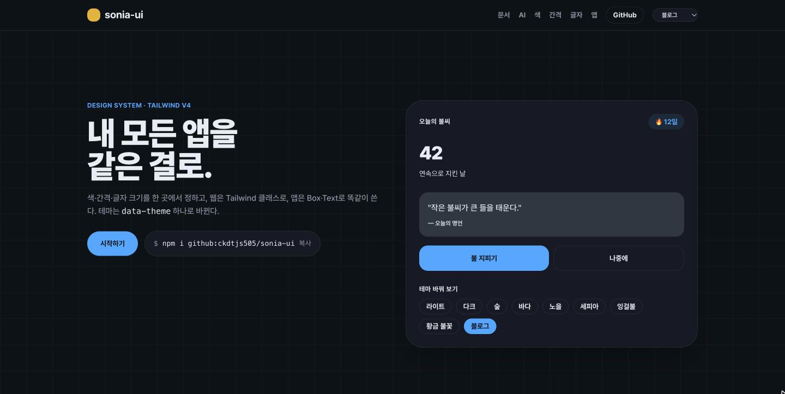
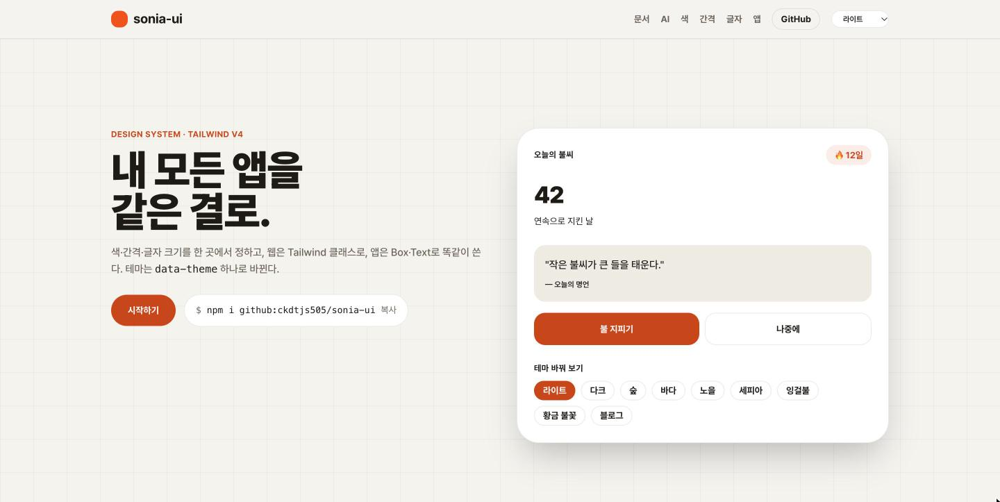
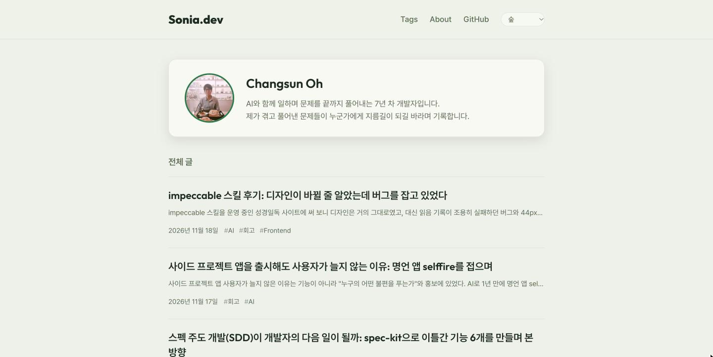
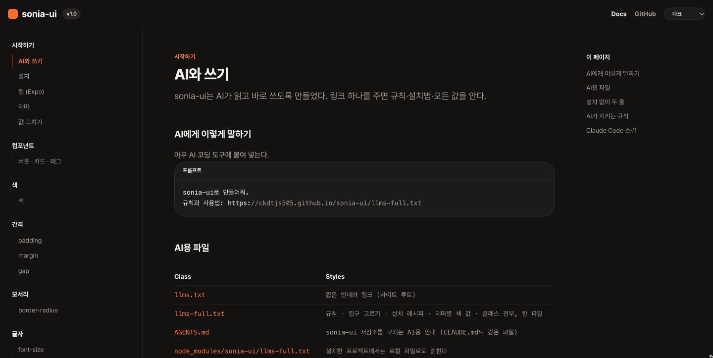
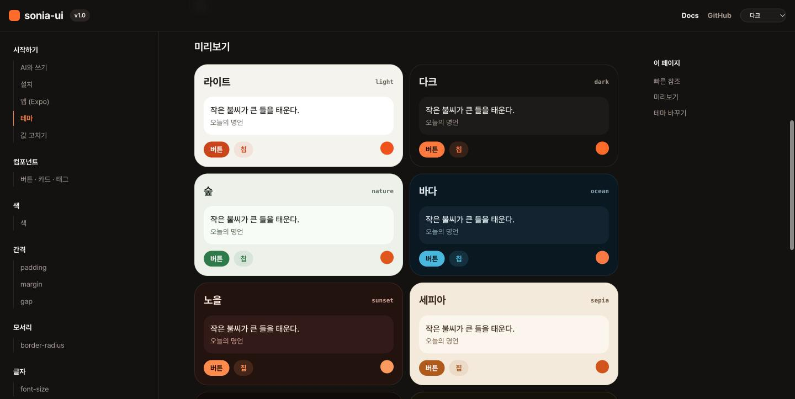
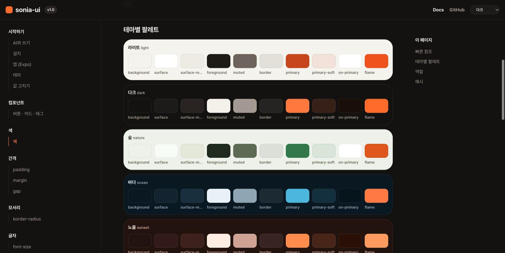
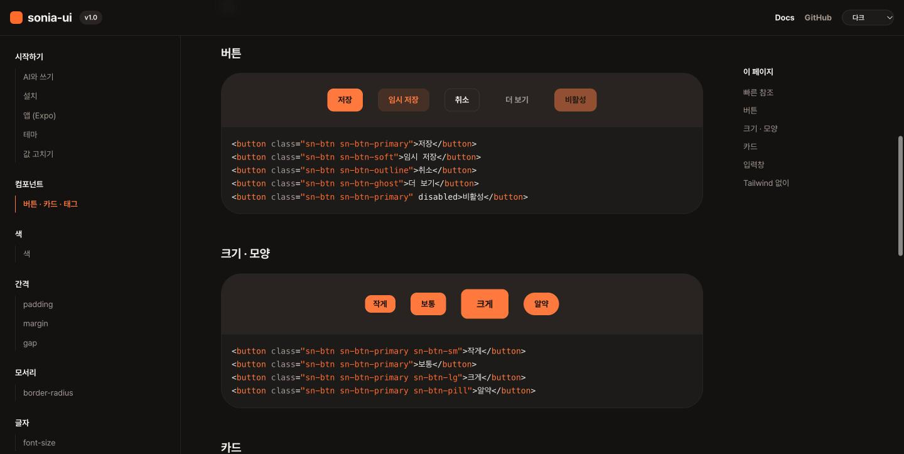

# sonia-ui

창선의 모든 앱·웹이 함께 쓰는 디자인 시스템. **모든 디자인은 여기서 만들고, 각 프로젝트는 가져다 쓴다.**



<table>
  <tr>
    <td></td>
    <td></td>
  </tr>
  <tr>
    <td align="center">같은 화면, 라이트 테마</td>
    <td align="center">블로그(Sonia.dev)도 같은 테마로 — 숲</td>
  </tr>
</table>

- 문서: https://ckdtjs505.github.io/sonia-ui/
- AI용 전체 레퍼런스: https://ckdtjs505.github.io/sonia-ui/llms-full.txt
- 저장소를 고치는 AI: [AGENTS.md](AGENTS.md)

## AI에게 맡기기



```
sonia-ui로 만들어줘. 규칙과 사용법: https://ckdtjs505.github.io/sonia-ui/llms-full.txt
```

Claude Code에서는 스킬로 연결해 두면 어느 프로젝트에서든 "sonia-ui로 만들어줘", "테마 붙여줘"로 끝난다.

```sh
ln -s ~/Desktop/web/sonia-ui/skill ~/.claude/skills/sonia-ui
```

## 설치 없이 두 줄

```html
<link rel="stylesheet" href="https://cdn.jsdelivr.net/gh/ckdtjs505/sonia-ui@1/src/css/base.css">
<script src="https://cdn.jsdelivr.net/gh/ckdtjs505/sonia-ui@1/src/browser/theme.js"></script>

<select data-theme-select></select>            <!-- 테마 고르기, 자동으로 채워짐 -->
<button class="sn-btn sn-btn-primary">저장</button>
```

## 어떤 걸 가져오나

`npm i github:ckdtjs505/sonia-ui` (버전 안 올려도 main 최신을 받는다)

| 프로젝트 | 가져올 것 |
|---|---|
| Tailwind v4 | `@import "tailwindcss"; @import "sonia-ui/tailwind.css";` |
| Tailwind 없는 웹 | `import "sonia-ui/base.css"` — 색 변수 + 기본 모양 + `sn-*` |
| 변수만 | `import "sonia-ui/themes.css"` |
| 테마 고르기 | `import "sonia-ui/theme.js"` + `<select data-theme-select>` |
| Expo | `sonia-ui/native` (+ `@shopify/restyle react-native-safe-area-context`) |
| JS에서 값 | `sonia-ui/tokens` (`getTheme`, `themeList`, `toCssVars`) |
| 테마 목록 JSON | `sonia-ui/themes.json` (`[{ id, name, scheme }]`) |

Next는 `transpilePackages: ["sonia-ui"]`, Jest는 `transformIgnorePatterns`에 `sonia-ui`. 글꼴은 [Pretendard](https://cdn.jsdelivr.net/gh/orioncactus/pretendard@v1.3.9/dist/web/variable/pretendardvariable-dynamic-subset.min.css) 링크 한 줄(없으면 시스템 글꼴).

### Tailwind v4

```html
<html data-theme="dark">
<div class="sn-card">
  <h1 class="text-title">안녕</h1>
  <p class="mt-xs text-caption text-muted">설명</p>
  <button class="sn-btn sn-btn-primary mt-lg">시작</button>
</div>
```

### Tailwind 없이

```html
<div class="sn-card">
  <h2 class="sn-text-heading">제목</h2>
  <p style="color: var(--color-muted); padding-top: var(--spacing-xs)">설명</p>
  <button class="sn-btn sn-btn-primary">저장</button>
</div>
```

모두 `@layer` 안에 있어서 프로젝트가 직접 쓴 CSS가 항상 이긴다. 기존 프로젝트에 붙여도 안 깨진다.

### Expo

```tsx
import { ThemeProvider, getTheme, Box, Text } from "sonia-ui/native";

<ThemeProvider theme={getTheme("dark")}>
  <Box backgroundColor="$background" padding="lg">
    <Text variant="title">안녕</Text>
  </Box>
</ThemeProvider>
```

## 테마 9종

`<html data-theme="…">` 하나로 화면 전체가 바뀐다. 모든 테마가 같은 색 이름을 갖고 값만 다르다.





## 컴포넌트



## 이름

| 종류 | Tailwind | 순수 CSS | Expo |
|---|---|---|---|
| 색 | `bg-primary` `text-muted` `border-border` | `var(--color-primary)` | `"$primary"` |
| 간격 `xs s md lg xl xxl hg` | `p-lg` `gap-md` | `var(--spacing-lg)` | `padding="lg"` |
| 모서리 `xs sm md lg xl pill` | `rounded-md` | `var(--radius-md)` | `borderRadius="md"` |
| 글자 `display title heading body stat label caption overline micro` | `text-title` | `.sn-text-title` | `variant="title"` |
| 테마 `light dark nature ocean sunset sepia ember gold sonia` | `<html data-theme="dark">` | 같음 | `getTheme("dark")` |

색 역할: `background` `surface` `surface-muted` `foreground` `muted` `border` `primary` `primary-soft` `on-primary` `flame`

컴포넌트: `sn-btn` + `-primary | -soft | -outline | -ghost` (`-sm | -lg | -pill`) · `sn-card` (`-muted`) · `sn-tag` (`-muted`) · `sn-input`

규칙: hex·px를 직접 쓰지 않는다. 다크 모드를 따로 만들지 않는다(테마가 해결). 값을 바꾸려면 프로젝트에서 덮지 말고 여기를 고친다.

## 고치기

| 바꾸려는 것 | 고칠 곳 |
|---|---|
| 색·간격·글자 값, 테마 추가 | `src/tokens/` |
| 기본 모양 · `sn-*` | `src/styles/` |
| 문서 · AI 문서 | `scripts/build-docs.ts` · `scripts/build-llms.ts` |

```sh
npm run build   # CSS · theme.js · themes.json · 문서 · llms-full.txt를 다시 만든다
```

main에 푸시하면 끝. 문서 사이트가 갱신되고, `src/`가 바뀌었으면 버전 태그(`v1.1.0` → `v1.1.1`)와 CDN `@1`도 자동으로 따라온다. 큰 변경이면 `package.json`의 `version`만 `1.2.0`으로 바꿔서 푸시.

## 쓰는 곳

self-fire(Expo) · [블로그](https://ckdtjs505.github.io/) · planner · 이 문서 사이트
